# 🏫 校园导游系统 SchoolGuide

> 一个基于 **「图（Graph）」** 数据结构的校园导游 Web 系统。
> 以校园景点为**顶点**、以道路为**边**构建带权无向图，使用 **Dijkstra** 与 **Floyd** 算法为来访客人提供最短路径问路查询，同时提供景点 / 道路信息的增删改查维护功能。
>
> 本项目为《数据结构》课程设计作品（Java Web 技术栈）。

<p align="center">
  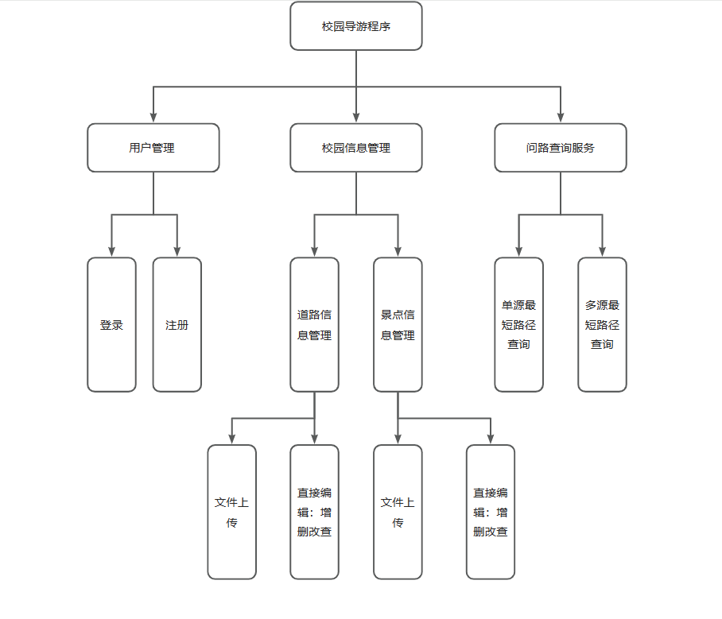
</p>
<p align="center"><sub>系统功能模块图：用户管理 / 校园信息管理 / 问路查询服务</sub></p>

---

## ✨ 功能特性

- 🔐 **用户登录 / 注册**：Session 会话保持，注册带图形验证码校验
- 🗺️ **校园地图可视化**：Canvas 实时绘制景点（圆点）与道路（连线）轮廓图
- 📍 **景点（顶点）管理**：分页查询、按名称/代号查询、新增、修改、删除、批量删除、txt 文件批量导入
- 🛣️ **道路（边）管理**：分页查询、按邻接点查询、新增、修改、删除、批量删除、txt 文件批量导入
- 🧭 **单源最短路径**：基于 **Dijkstra** 算法，查询某景点到其余所有景点的最短路径
- 🔀 **两地间最短路径**：基于 **Floyd** 算法，查询任意两景点间的最短路径并以时间轴展示

---

## 🖼️ 界面预览

### 登录 / 注册

| 登录页 | 注册页（验证码） |
| :---: | :---: |
|  |  |

### 景点管理（顶点 CRUD）

<p align="center">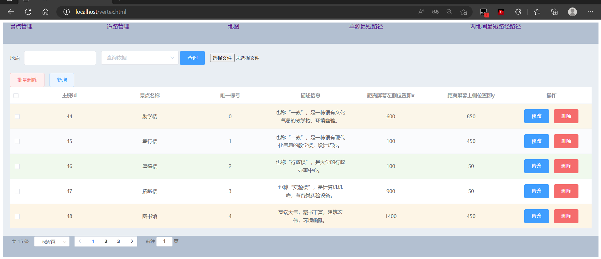</p>
<p align="center"><sub>景点列表：分页、查询、新增、修改、删除、批量删除、文件导入</sub></p>

<table>
  <tr>
    <td align="center">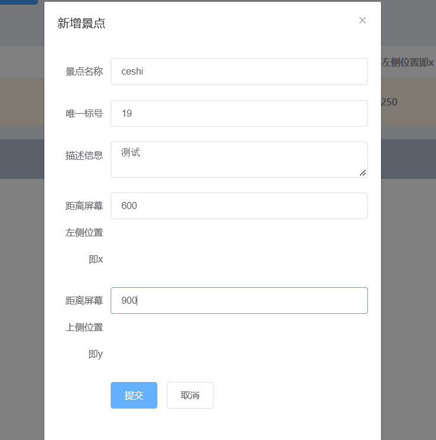<br><sub>新增景点</sub></td>
    <td align="center">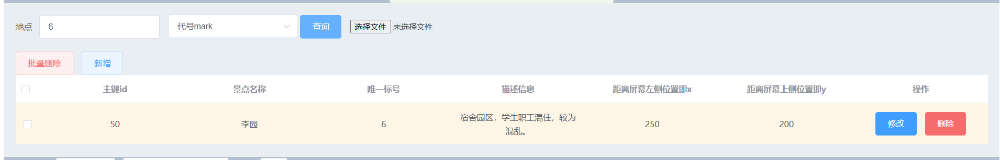<br><sub>按代号 mark 查询</sub></td>
  </tr>
  <tr>
    <td align="center" colspan="2">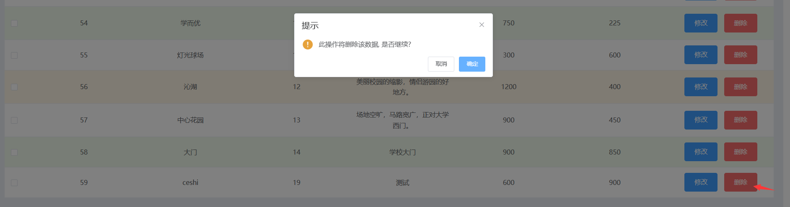<br><sub>删除二次确认</sub></td>
  </tr>
</table>

### 校园地图（Canvas 可视化）

<p align="center">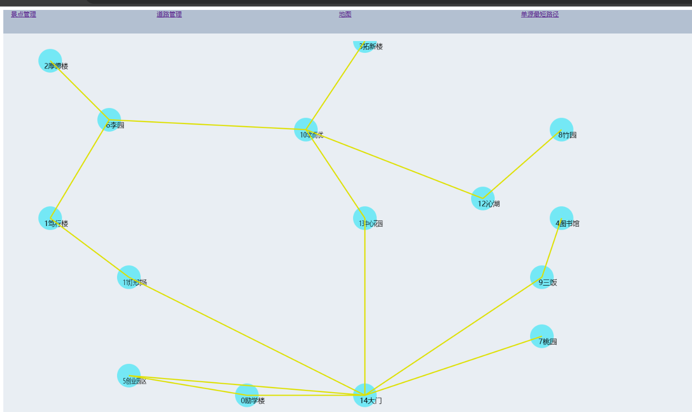</p>
<p align="center"><sub>以顶点表示景点、以边表示道路，实时渲染校园轮廓图</sub></p>

### 问路查询（最短路径）

| 单源最短路径（Dijkstra） | 两地间最短路径（Floyd） |
| :---: | :---: |
| 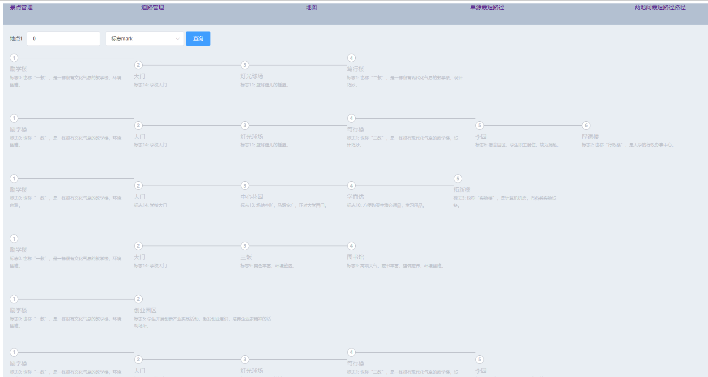 | 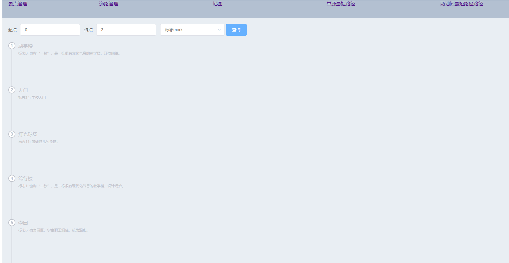 |

---

## 🧱 技术栈

### 后端

| 技术 | 版本 | 说明 |
| --- | --- | --- |
| Java | 8 | 开发语言 |
| Servlet | 3.1 | Web 层（注解 `@WebServlet` + 反射分发） |
| MyBatis | 3.5.5 | ORM / SQL 映射 |
| MySQL | 5.x | 数据存储（`school_guide_system`） |
| Maven | - | 构建 & 依赖管理 |
| tomcat7-maven-plugin | 2.2 | 内嵌 Tomcat 一键运行 |
| fastjson | 1.2.28 | JSON 序列化 |
| slf4j + logback | 1.7.20 / 1.2.3 | 日志 |
| JUnit | 4.13 | 单元测试 |

### 前端

| 技术 | 说明 |
| --- | --- |
| HTML / CSS / JavaScript | 页面与样式 |
| Vue 2.7 | 视图绑定 |
| Element-UI | 组件库（表格、弹窗、分页、步骤条等） |
| Axios | 前后端 JSON 通信 |
| Canvas 2D | 校园地图绘制 |

---

## 🧮 数据结构与算法

系统核心是「图」的两种存储结构与两个经典最短路算法：

- **邻接表 `ALGraph`**：顶点表 `ArrayList<ALVertexNode>` + 每个顶点的边链表 `ALEdgeNode`，适合稀疏图与 Dijkstra 遍历邻接点。
- **邻接矩阵 `MGraph`**：`List<ArrayList<Integer>>` 二维权值矩阵，可由邻接表 `ToMGraph()` 转换得到，适合 Floyd 动态规划。
- **绘图模型 `DrawGraph`**：携带顶点坐标（left/top）与边集合，供前端 Canvas 渲染。

| 算法 | 位置 | 用途 | 时间复杂度 |
| --- | --- | --- | --- |
| Dijkstra（单源） | `GraphServiceImpl#singleShortestPathAll` | 源点到所有景点的最短路径 | O(V²) |
| Floyd（多源） | `GraphServiceImpl#mutipleShortestPath` | 任意两点间最短路径 | O(V³) |

<p align="center">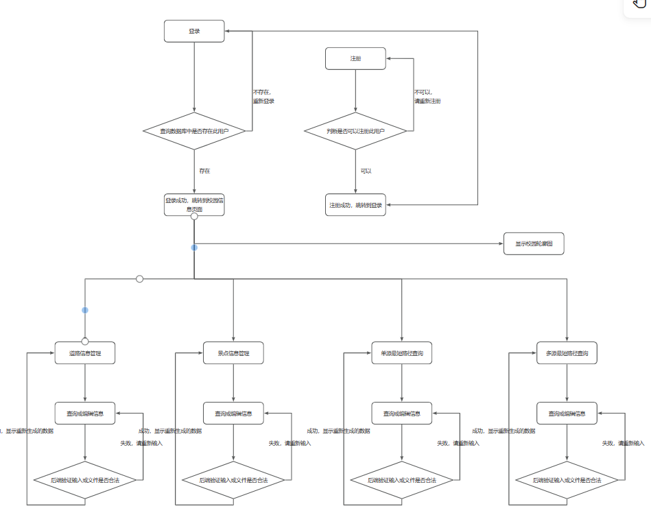</p>
<p align="center"><sub>系统整体流程图：登录/注册 → 信息管理 / 地图展示 / 问路查询</sub></p>

---

## 🗄️ 数据库设计

数据库名：`school_guide_system`，共 3 张表：

| 表 | 字段 | 说明 |
| --- | --- | --- |
| `vertex` | id, name, mark, data, left, top | 景点（顶点）：名称、唯一代号、简介、画布坐标 |
| `edge` | id, mark1, mark2, distance, walk_time, ride_time | 道路（边）：两邻接点代号、距离、步行/骑行时间 |
| `user` | id, username, passwd, phonenumber | 用户 |

<p align="center">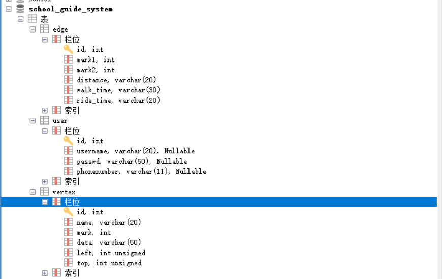</p>

---

## 🚀 快速开始

**环境要求**：JDK 8+、Maven 3+、MySQL 5.x

1. **克隆仓库**

   ```bash
   git clone <repo-url> SchoolGuide
   cd SchoolGuide/210417-xsc/SchoolGuide
   ```

2. **准备数据库**：创建 `school_guide_system` 库并按上文建 `vertex` / `edge` / `user` 三张表；
   如连接信息不同，请修改 `src/main/resources/mybatis-config.xml` 中的 `url / username / password`。

3. **导入初始数据（可选）**：登录系统后，在「景点管理 / 道路管理」页通过 **选择文件** 上传仓库根目录的
   `210417-xsc/vertex.txt` 与 `210417-xsc/edge.txt` 批量导入示例数据。

4. **启动服务**（内嵌 Tomcat，端口 80）

   ```bash
   mvn tomcat7:run
   ```

   或在 IDEA 中：右键项目 → Run Maven → `tomcat7:run`：

   <p align="center">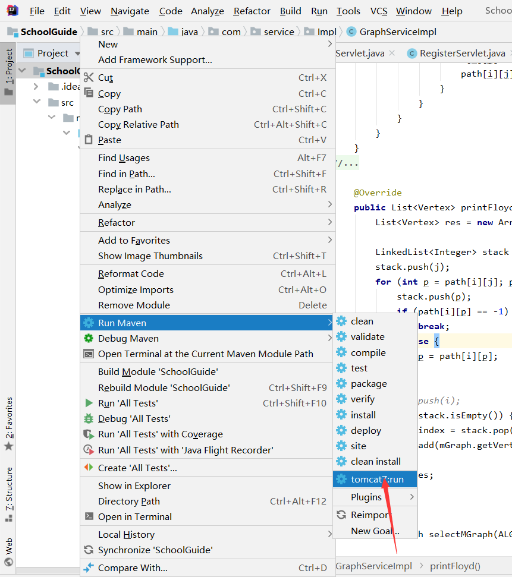</p>

5. **访问系统**：浏览器打开 <http://localhost/>，注册 / 登录后即可使用。

---

## 📁 项目结构

```
SchoolGuide/
├── readme.md
├── 报告.doc                          # 课程设计报告
└── 210417-xsc/
    ├── vertex.txt                    # 景点初始数据（可文件导入）
    ├── edge.txt                      # 道路初始数据（可文件导入）
    └── SchoolGuide/                  # Maven Web 工程
        ├── pom.xml
        └── src/
            ├── main/
            │   ├── java/com/
            │   │   ├── pojo/         # 数据模型：Vertex/Edge/User + 图结构 ALGraph/MGraph/DrawGraph
            │   │   ├── mapper/       # MyBatis Mapper 接口
            │   │   ├── service/      # 业务层（GraphService 含 Dijkstra/Floyd）
            │   │   ├── utils/        # 验证码、SqlSessionFactory 工具
            │   │   └── web/app/      # Servlet 控制层（login/register/vertex/edge/graph）
            │   ├── resources/
            │   │   ├── mybatis-config.xml
            │   │   └── com/mapper/   # SQL 映射 XML
            │   └── webapp/           # 前端页面
            │       ├── login.html / register.html
            │       ├── map.html / vertex.html / edge.html
            │       ├── shortestRoute.html / mutipleRoute.html
            │       ├── css/ js/ imgs/ element-ui/
            └── test/java/com/mapper/ # JUnit 测试
```

---

## 🔌 主要接口

| 接口 | 方法 | 说明 |
| --- | --- | --- |
| `/LoginServlet` | POST | 登录校验 |
| `/RegisterServlet` | POST | 注册 |
| `/CheckCodeServlet` | GET | 生成图形验证码 |
| `/VertexServlet/selectByPage` | GET | 景点分页查询 |
| `/VertexServlet/selectByMarkOrName` | POST | 按代号/名称查询景点 |
| `/VertexServlet/addVertex` | POST | 新增景点 |
| `/VertexServlet/modifyVertex` | POST | 修改景点 |
| `/VertexServlet/deleteByIds` | POST | 批量删除景点 |
| `/VertexServlet/acceptTxt` | POST | txt 文件批量导入景点 |
| `/EdgeServlet/selectByPage` | GET | 道路分页查询 |
| `/EdgeServlet/addEdge` / `modifyEdge` / `deleteByIds` / `acceptTxt` | POST | 道路增 / 改 / 删 / 导入 |
| `/GraphServlet/drawAll` | GET | 返回绘图模型（Canvas 渲染） |
| `/GraphServlet/singleShortestPath` | POST | 单源最短路径（Dijkstra） |
| `/GraphServlet/mutipleShortestPath` | POST | 两地间最短路径（Floyd） |

---

## 🧪 测试

`src/test/java/com/mapper/` 下提供 `VertexTest` / `EdgeTest` 单元测试，覆盖 Mapper 与 Service 的增删改查：

```bash
mvn test
```

---

## 📄 说明

- 本项目为课程学习用途的练手作品，部分历史代码保留在 `弃用/` 目录中供参考。
- 详细设计思路、算法伪码与测试过程见仓库根目录 `报告.doc`。
